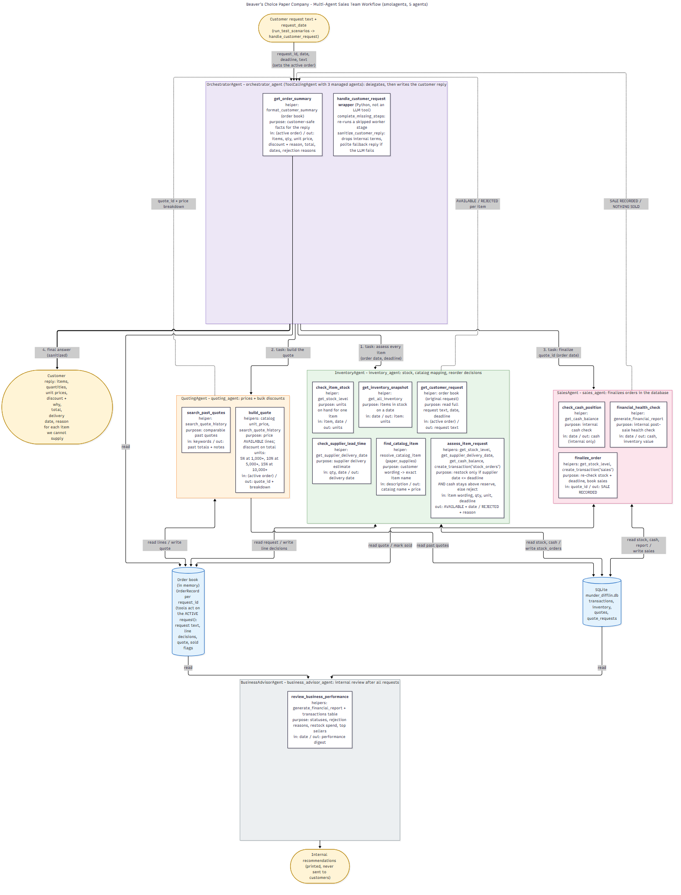

# Beaver's Choice Paper Company – Multi-Agent Sales Team

Reflection report for the Udacity *Multi-Agent Systems* final project.
All code is in `project_starter.py`; the evaluation output is `test_results.csv`; the diagram is
`workflow_diagram.png` (source: `workflow_diagram.mmd`).

---

## 1. System overview and workflow diagram

The system uses **five agents** (the project maximum), all built with `smolagents.ToolCallingAgent`
and the `gpt-4o-mini` model behind the Vocareum OpenAI proxy:

| Agent (code name) | Role (no overlap with the others) | Tools → starter helper(s) used |
|---|---|---|
| **OrchestratorAgent** (`orchestrator_agent`) | Receives the customer request, delegates to the three workers in a fixed order (inventory → quoting → sales), then writes the customer reply. Never touches stock, prices or the ledger itself. | `get_order_summary` (customer-safe view of the order). Managed agents: `inventory_agent`, `quoting_agent`, `sales_agent`. |
| **InventoryAgent** (`inventory_agent`) | Reads the original request, splits it into items, maps each item to the exact catalog name, converts units (ream = 500 sheets, pack = 100, box = 5,000), checks stock and decides whether to restock or reject each item. | `get_customer_request`, `get_inventory_snapshot` → `get_all_inventory`; `find_catalog_item` → catalog matching; `check_item_stock` → `get_stock_level`; `check_supplier_lead_time` → `get_supplier_delivery_date`; `assess_item_request` → `get_stock_level`, `get_supplier_delivery_date`, `get_cash_balance`, `create_transaction('stock_orders')` |
| **QuotingAgent** (`quoting_agent`) | Prices the items that the inventory agent marked AVAILABLE at catalog prices and applies the bulk-discount tier; checks quote history for consistency. | `build_quote` → catalog `unit_price`, `search_quote_history`; `search_past_quotes` → `search_quote_history` |
| **SalesAgent** (`sales_agent`) | Finalizes the quote: re-checks stock and the deadline, books one `sales` transaction per item, and runs an internal financial health check. | `check_cash_position` → `get_cash_balance`; `finalize_order` → `get_stock_level`, `create_transaction('sales')`; `financial_health_check` → `generate_financial_report` |
| **BusinessAdvisorAgent** (`business_advisor_agent`, optional stand-out) | Runs once after all requests, reviews every order and the ledger, and prints internal recommendations. Never talks to customers. | `review_business_performance` → `generate_financial_report` + transactions table |

All seven required helpers are used inside tools: `create_transaction`, `get_all_inventory`,
`get_stock_level`, `get_supplier_delivery_date`, `get_cash_balance`, `generate_financial_report`
and `search_quote_history`.

### How a request flows (the arrows in the diagram)

1. `run_test_scenarios()` sends each request, in date order, to `handle_customer_request()`. This
   wrapper registers an `OrderRecord` in an in-memory **order book** and marks it as the *active*
   request.
2. The orchestrator calls **inventory_agent**. It reads the full request with `get_customer_request`
   and calls `assess_item_request` once per item. That tool writes an AVAILABLE or REJECTED decision
   for each line into the order book. If stock is short, it places a supplier order
   (`stock_orders`) only when **both** conditions hold: the supplier date is on or before the
   customer's deadline, and cash stays above a $5,000 reserve. Otherwise it rejects the item with a
   customer-safe reason.
3. The orchestrator calls **quoting_agent**. `build_quote` prices the AVAILABLE lines and applies the
   discount on the order's total units: 5% at 1,000+, 10% at 5,000+, 15% at 10,000+. It stores quote
   `Q-<request_id>` in the order book.
4. The orchestrator calls **sales_agent**. `finalize_order` re-checks stock and dates, then writes
   one `sales` row per line to SQLite. That changes the cash balance.
5. The orchestrator calls `get_order_summary` and writes the customer letter from those facts only.
   The wrapper then checks that the letter quotes the booked total and removes any internal terms
   (see section 5).

### Why this architecture (decision process)

* **One agent per business capability.** The rubric names three distinct jobs: inventory, quoting
  and sales finalization. Giving each its own agent and its own tool set means a responsibility can
  only live in one place. For example, only the inventory agent can create `stock_orders` and only
  the sales agent can create `sales`. The orchestrator owns no business tools at all, so it cannot
  bypass the workers.
* **Deterministic tools, LLM for language.** Early tests showed that `gpt-4o-mini` is reliable at
  *reading* requests and *writing* replies, but it made bookkeeping mistakes when it had to carry
  numbers or ids between agents. In one smoke test it booked items on the wrong request id.
  Because of that:
  * business rules (unit conversion, stock, lead time, cash reserve, discounts) live in plain Python
    inside the tools;
  * tools act on the **active request** held by the order book instead of an id typed by the LLM;
  * agents exchange short ids (`Q-R3`) instead of re-typing prices.
* **Idempotent, ordered tools.** `assess_item_request` refuses to change a line twice and locks
  once quoted. `build_quote` refuses to re-price a booked order. `finalize_order` never double-books.
  The orchestrator model runs with `parallel_tool_calls=False`, so the three delegations always
  happen in sequence.
* **Safety net, not a shortcut.** `complete_missing_steps()` re-runs a worker agent if the
  orchestrator skipped a stage. It also re-asks the inventory agent when fewer items were assessed
  than the number of quantities found in the request text. In the final evaluation run it was
  needed **0 times**, so all 20 requests went through the normal orchestrator → worker path. In an
  earlier full run the orchestrator stopped early on 2 requests; the safety net finished those
  orders with the same bookings.
* **Fifth agent spent on insight.** The four core agents cover the workflow, so the last allowed
  slot went to a business advisor (a rubric stand-out suggestion). It does not touch the customer
  path.

---

## 2. Framework choice

**smolagents 1.26.0** was used (pinned in `requirements.txt`).

* `@tool` turns a typed, docstring-documented Python function into an LLM tool. The starter helpers
  could be wrapped with almost no boilerplate.
* `managed_agents=[...]` gives a native orchestrator/worker pattern: each worker shows up to the
  orchestrator as a callable tool with a `task` argument. That matches the rubric's "orchestrator
  that manages task delegation" directly.
* `ToolCallingAgent` uses the model's native function calling, which is more predictable with a
  small model than generating and executing Python code (`CodeAgent`). It also keeps the agents
  away from arbitrary code execution.
* `OpenAIServerModel` works with the Vocareum OpenAI-compatible endpoint out of the box.
  `temperature=0` keeps the runs repeatable.

pydantic-ai would have given stricter typed outputs, but smolagents' built-in managed-agent
delegation made the multi-agent structure simpler and easier to show in the diagram.

---

## 3. Evaluation results (`test_results.csv`)

All 20 requests in `quote_requests_sample.csv` were processed in request-date order from a freshly
initialised database. The run completed with no errors.

| Metric | Result |
|---|---|
| Requests processed | 20 |
| Requests that changed the cash balance | **19** (all except request 15) |
| Fully fulfilled (every item supplied) | **6** (requests 1, 4, 5, 6, 10, 12) |
| Partially fulfilled (some items supplied, others rejected with a reason) | **13** |
| Not fulfilled (nothing could be supplied) | **1** (request 15) |
| Item lines assessed | 60: 37 supplied, 11 rejected (not in catalog), 12 rejected (supplier date after deadline) |
| Supplier restock orders placed | 30 |
| Sales revenue booked | $12,138.90 |
| Cash: start → end | $45,059.70 → $49,216.17 (**+$4,156.47** after paying for all restocks) |
| Safety-net interventions | 0 |
| Customer replies written by the LLM / fallback template | 20 / 0 |

### Example responses

* **Fulfilled with rationale (request 1).** 200 glossy, 100 cardstock and 100 colored sheets at
  $0.20 / $0.15 / $0.10. Total $65.00, delivery 2025-04-02. The letter explains that no discount
  applies because the order totals 400 units and discounts start at 1,000 units.
* **Bulk discount (request 3).** 10,000 A4 sheets plus 500 reams of printer paper (converted to
  250,000 sheets of *Standard copy paper*). Both were restocked from the supplier in time for the
  2025-04-15 deadline. Subtotal $10,500.00, 15% tier discount (−$1,575.00), total $8,925.00. The A3
  paper line was rejected: "We do not carry A3-size paper; our sheet formats are A4, letter and
  legal size."
* **Partial order with deadline reasons (request 9).** The A4 paper ships next day for $10.00. The
  envelopes were rejected because "the earliest restock would arrive on April 14, 2025, after your
  April 10, 2025 deadline". The A3 glossy paper was declined because the format is not carried.
* **Not fulfilled (request 15).** 10,000 A4 sheets ordered on 2025-04-12 for 2025-04-15: a
  restock of that size takes 7 days, so it would arrive 2025-04-19. A3 paper and cardboard are not
  carried. The customer gets a reason per item and an offer of in-stock alternatives such as
  cardstock.
* **Mixed discount and rejection (request 20).** 5,000 flyers and 2,000 posters with a 10% discount
  (7,000 units, 5,000+ tier). Total $1,125.00, delivery 2025-04-24. Tickets were declined because
  the company does not print them.

### Strengths

1. **Correct, auditable bookkeeping.** Every cash change in `test_results.csv` can be traced to
   explicit `stock_orders` and `sales` rows. No order was double-booked or booked on the wrong
   date, and quote totals always equal the booked sales.
2. **Business rules are applied the same way every time.** Restocking happens only when the
   supplier can deliver on time and cash allows. All 12 deadline rejections state the exact
   supplier date and the customer's deadline.
3. **Robust name and unit mapping.** Requests such as "8.5"x11" colored paper", "poster boards
   (24" x 36")", "500 reams of printer paper" and "decorative washi tape" all resolved to the right
   catalog item and quantity.
4. **Transparent replies.** All 20 replies list quantities, unit prices, discount and rationale,
   total and delivery date. None contained internal data (an automated scan for cash, margin,
   profit, agent, error and similar terms found nothing).
5. **Resilient orchestration.** Idempotent tools, ordered delegation and the safety net mean an LLM
   slip cannot corrupt the ledger. Three full runs produced identical cash figures, including one
   where the safety net had to finish two orders.

### Areas to improve (observed in the run)

* Only 6 of 20 requests were *fully* fulfilled. Most partial orders come from formats we do not
  stock (A3/A5, 11 lines) or from short deadlines. Requests 15–19 arrive 1–3 days before the
  2025-04-15 deadline, while any restock above 100 units takes 4–7 days.
* `generate_financial_report` (starter helper) values only the items in the `inventory` reference
  table. Items that were restocked but are not in that table (e.g. *Standard copy paper*, *Flyers*)
  change cash but not `inventory_value`. That is why `inventory_value` in `test_results.csv` moves
  less than expected.
* Partial availability is all-or-nothing per line. If 135 sheets are in stock but 1,000 are
  requested and a restock is too slow, the customer is not offered the 135 sheets.
* The small model does not always finish the full delegation sequence. It completed every request
  in the final run, but in an earlier run 2 of 20 requests needed the safety net and got an accurate
  but less personal template letter.
* The LLM sometimes restates converted quantities loosely. For example, request 9's letter says "50
  requested" for 50 packets that the summary shows as 5,000 envelopes.

---

## 4. Suggestions for further improvement

1. **Proactive replenishment driven by the business advisor.** Today restocking is reactive and
   only happens when an order is short. A nightly job could restock any item that falls below
   `min_stock_level`, using the advisor's top-seller list and typical lead times. Fast-moving paper
   would then be on the shelf before large, short-notice orders arrive. That would have turned
   several partial orders in requests 15–19 into full ones.
2. **Partial-quantity and substitute offers.** When a line cannot be met in full, the inventory
   agent could offer two options: the in-stock quantity now plus the rest on the supplier date, or
   the closest catalog substitute (e.g. A4 for A3, cardstock for cardboard). Each option would be
   priced by the quoting agent, and the customer could accept one in a follow-up message.
3. **Structured agent outputs and evaluation tests.** Have each worker return a typed object
   (supported by smolagents' structured outputs or pydantic-ai) instead of free text. Add a pytest
   suite for the deterministic tools: unit conversion, discount tiers, lead-time rule and the
   reply sanitiser. Regressions would then be caught without spending API budget.
4. **Customer negotiation agent (stand-out idea).** Use the job, event and need-size columns to
   simulate a customer who counters quotes, within a configured discount ceiling, so pricing can
   be tested under negotiation.

---

## 5. Transparent and safe customer outputs

* **Complete information.** The orchestrator writes the letter only from `get_order_summary`. That
  summary lists every requested item with its catalog name, quantity, unit price, line amount,
  discount percentage and amount, total and delivery date, plus every rejected item.
* **Rationale for every decision.** Discounts state the tier and the unit total that triggered
  them, or why no discount applies. Rejections state the concrete cause: the product is not in the
  catalog, or the earliest restock date is after the customer's deadline.
* **No internal data.** Cash balance, supplier cost (60% of list price), margins, inventory value
  and the financial report are seen only by the sales and advisor agents and are marked
  "INTERNAL" in their tool docstrings. Before a reply is returned:
  * `sanitize_customer_reply()` drops any line that mentions internal terms (cash, margin, profit,
    supplier cost, inventory value, agent or tool names, error, traceback);
  * `reply_matches_order()` checks that the letter quotes the booked total;
  * if either check fails, a deterministic template built from the same safe summary is sent
    instead.
* **Errors become polite messages.** `handle_customer_request()` catches all exceptions, logs them
  internally (`internal_notes`) and still returns a courteous, accurate reply. Stack traces never
  reach the customer.
* **No PII.** Letters are addressed "Dear Customer" and signed by the sales team. The customer's
  job title and event are used only to set the tone. No names, e-mails or addresses are produced
  or stored.
